# Monitoring'e AI Katmanı

*Alarmlarla dolu bir monitoring ürününün üstüne yapay zekâ koyunca ne oluyor?*

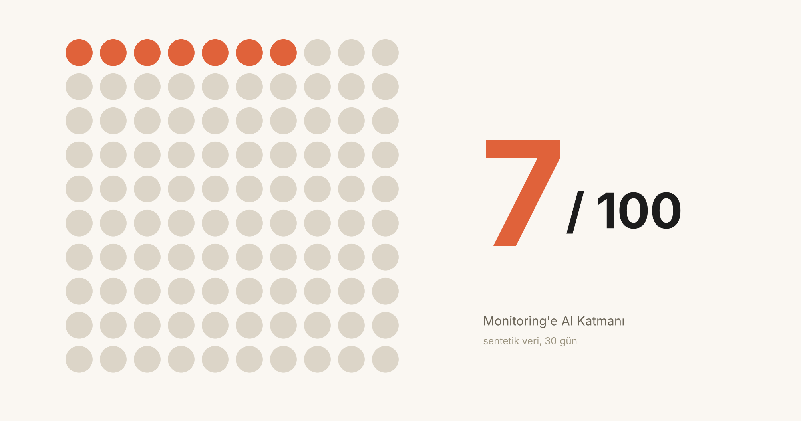

Kapaktaki rakam sentetik bir veri setinden: 30 günlük alarm akışında her 100 alarmdan 7'si gerçekten birinin müdahalesini gerektiriyor. Gerçek ortamımın rakamı değil, nedenini aşağıda anlatıyorum.

## Neden bu seriyi yazıyorum?

Şirkette kullandığımız monitoring ürününde bir sürü alarm geliyor. Ürün işini yapıyor, bir şey ters gidince haber veriyor. Asıl iş ondan sonra başlıyor. Bu alarm önemli mi? Öbürleriyle aynı olayın parçası mı? Sebebi ne? Daha önce görmüş müydük, ne yapmıştık? Bunların cevabı ekranda yazmıyor. Biri bakıp kafasında birleştiriyor.

Aklıma hep aynı soru geliyor: yapay zekâ bu işte ne kadar kullanılabilir? Özetlemek kolay, ama kök nedeni bulabilir mi? Eski incident'lara bakıp "şunu yap" diyebilir mi? Aksiyonu kendisi mi almalı?

Sektör de aynı yöne gidiyor. Datadog, Dynatrace ve New Relic artık kendi AI SRE ajanlarını sunuyor ([Mezmo](https://www.mezmo.com/learn/the-2026-ai-sre-market-map-agents-harnesses-and-the-data-layer)). Mesela Dynatrace'in Davis'i alarmları zamana bakıp yan yana koymuyor, sistemin topolojisini dolaşıp kök nedeni arıyor ([Dynatrace](https://www.dynatrace.com/news/blog/ai-driven-analytics-and-automation-for-unified-observability/)). Kendi ortamlarında günde yüz binlerce olayı dört beş incident'a indirdiklerini yazıyorlar ([Dynatrace](https://dynatrace.com/news/blog/advancing-aiops-preventive-operations-powered-by-davis-ai)).

Bu ürünler kötü değil, şirketteki ortamda bunları test ettim. Ama bana üç sebepten yetmiyor. Test sonuçlarını bu yazıya koymadım. Aşağıdaki mimari ve fiyat bilgileri yayımlanmış kaynaklardan, sözleşmelerdeki gerçek rakamlar farklı olabilir.

**Birincisi, kendi veri katmanlarında çalışıyorlar.** Rakip firma Better Stack'in yazısına göre (taraflı olabilir) Davis'in analizi her host'taki OneAgent'a, Grail veri katmanına ve Smartscape topolojisine dayanıyor ([Better Stack](https://betterstack.com/community/comparisons/davis-ai-alternatives/)). Zabbix, Prometheus ve ELK ile çalışan bir ortamda tam verim için işin büyük kısmını o platforma taşımak gerekebilir.

**İkincisi, maliyet.** Bu ürünler pahalı. Dynatrace host başına saat ücretiyle çalışıyor, Full-Stack izleme host'un belleğine göre ücretleniyor, log alımı ayrıca fiyatlanıyor ve hepsinin üstüne yıllık taahhüt geliyor ([rate card](https://dynatrace.com/pricing/rate-card), [Last9](https://last9.io/blog/dynatrace-pricing/)). Datadog'da kök neden araştırması da ayrı bir AI kredisiyle ölçülüyor ([Datadog](https://www.datadoghq.com/pricing/?facet1=pdf)). Host, log ve araştırma sayısı büyüdükçe fatura da büyüyor.

**Üçüncüsü, gizlilik.** Bazı şirketlerde alarm ve log verisi dışarı çıkamıyor, çünkü içinde sunucu adları, müşteri bilgileri, iç sistemlerin yapısı var. Claude ya da GPT gibi güçlü modelleri API'den kullanmak her yerde mümkün değil. Peki şirketin kendi sunucusunda (on-prem) çalışan, az kaynak isteyen küçük bir model, şirketin kendi verisiyle fine-tune edilirse ne kadar iş görür? Büyük modelle arasındaki fark ne kadar? Bunu kendi bilgisayarımda deneyip rakamlarla göstereceğim. Şirket verisini yayımlayamayacağım için deneyi anonimleştirilmiş ya da sentetik veriyle yapacağım ve hangisi olduğunu her seferinde yazacağım.

## Seride neler olacak?

Elimdeki ürünlere dokunmayacağım. Üstlerine kendi AI katmanımı kuracağım: alarmları toplasın, birbirine bağlasın, kök nedene yaklaşsın, eski incident'lardan çözüm önersin, eşikleri sorgulasın. Sonunda işe yarayıp yaramadığına sayılarla bakacağım.

Kurallarım var. Her yazıda "ne işe yaramadı" bölümü olacak. Her yazı tek başına okunabilecek. Gerçek veri varsa onu, yoksa sentetik veriyi kullanacağım ve hangisi olduğunu yazacağım. Mümkün olduğunca rakamla konuşacağım. Hiçbir satıcının tarafında değilim.

Toplam 12 yazı, iki sezon. İlkinde alarmları görüp anlıyoruz, ikincisinde geçmişten öğrenip harekete geçiyoruz.

Bitmiş hali kabaca şöyle olacak: mevcut ürünler olduğu gibi kalıyor, AI katmanı onların verisini okuyup öneri üretiyor, aksiyonu insan onaylıyor.

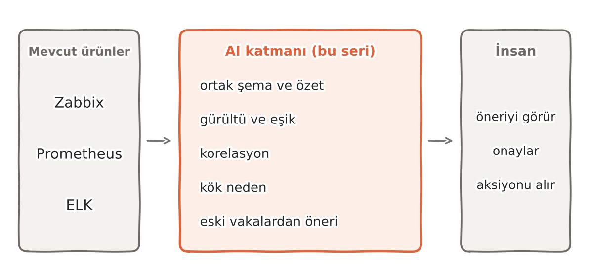

Yazılar da bu sırayla ilerliyor.

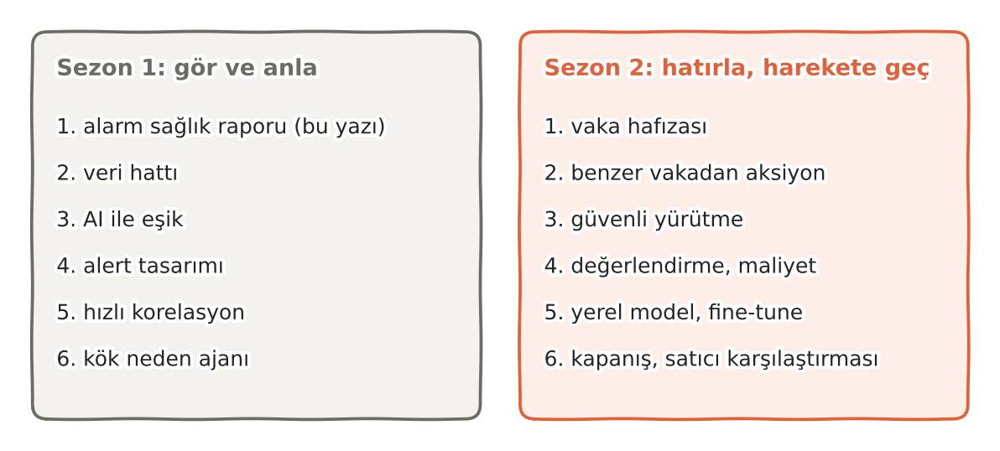

---

## Bölüm 1: Alarmları saydım

*AI'a geçmeden önce yaptığım ilk iş.*

AI alarmlarımı daha hızlı çözüyor diyebilmem için şu an ne kadar hızlı çözdüğümü bilmem lazım. O yüzden önce ölçüm aracını kurdum ve sentetik veriyle denedim. Kendi ortamımın sayıları bir sonraki adım. Datadog bile kendi ajanını gerçek incident'larda, insan etiketli sonuçlarla ve bir LLM hakemle değerlendirdiğini yazıyor ([Datadog](https://datadoghq.com/blog/building-bits-ai-sre/)). Ben de o işi küçük ölçekte kendime uyguladım. Bu yazıda hiç AI yok. Sadece alarmların sağlık raporunu çıkaran bir araç, onun üç yanlış denemesi ve sınırları var.

> **Veri notu:** Aşağıdaki 30 günlük sayılar gerçek bir ortamdan gelmiyor. Bilinen davranışlara sahip bir üreticiyle (`alerthealth generate`) kurduğum, tekrar üretilebilen bir veri seti bu. Hangi kuralın gürültülü, hangi alarmın gerçek olduğunu üretirken ben belirledim. Yani sayılar gerçek dünyadaki oranları değil, yöntemin ve aracın nerede doğru, nerede yanlış çalıştığını gösteriyor. Kendi ortamında çalıştırınca başka sayılar göreceksin.

### Lab'da tek bir arıza

Prometheus, node_exporter, Alertmanager ve Zabbix 5.0.17'den oluşan bir test ortamı kurdum. Sonra `stress-ng` ile 120 saniyelik bir CPU yükünü iki kez bindirdim. İlk denemede yalnızca Prometheus alarm verdi. Ekran görüntülerini ayrıca, benzer bir yük sırasında aldım, bu yüzden saatler birbirini tutmuyor.

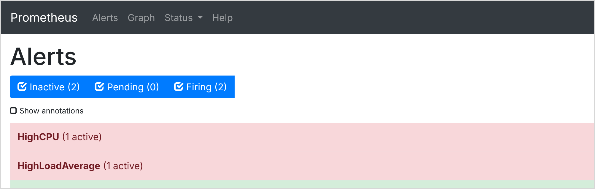
*Prometheus: HighCPU ve HighLoadAverage firing.*

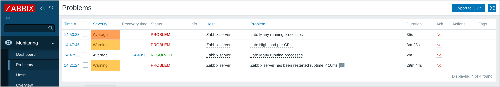
*Zabbix: "Many running processes" ve "High load per CPU" aynı arızadan geldi. "RESOLVED" satırı önceki denemeden, "restarted" satırı da Zabbix'in kendi açılışından kalma.*

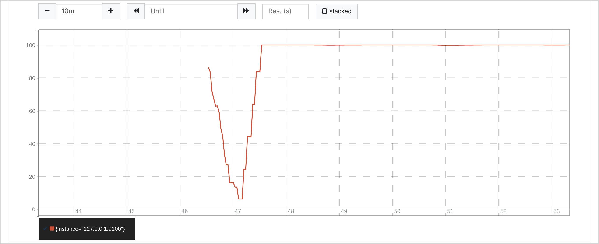
*CPU kullanımı yüzde 100'e yapışıyor.*

İkinci denemede tek sebep, iki araç, dört alarm. Aynı makine iki ayrı isimle geçiyor: Zabbix'te `Zabbix server`, Prometheus'ta `127.0.0.1:9100`. Bir de iki arıza arasında, arızayla ilgisiz bir Zabbix alarmı (timer process kullanımı) vardı, büyük ihtimalle açılışa özgü ama doğrulamadım. Toplam 7 alarm: ilk arızadan 2, ikinciden 4, ilgisiz 1. Küçücük bir labda bile birden çok alarm, tutarsız isimler ve gürültü çıktı. Gerçek ortamda ne kadar katlandığını görmek için saymak gerekiyor.

### Veriyi tek yerde toplamak

Üç kaynaktan gelen alarmı aynı forma çeviriyorum. Bir alarm, bir satır:

```json
{"id": "zbx:11234", "source": "zabbix", "rule": "High load per CPU",
 "entity": "Zabbix server", "severity": "warning",
 "started_at": "2026-11-22T13:47:05Z", "ended_at": "2026-11-22T13:48:55Z",
 "acked_at": null, "actionable": null, "incident_id": null, "labels": {}}
```

`actionable` alanı önemli: "Bu alarm gerçekten bir insanı harekete geçirdi mi?" Ticket kayıtlarından ya da on-call notlarından doldurulabilir. Bu alan olmadan gürültüyü ölçemiyorsun, sadece hissediyorsun.

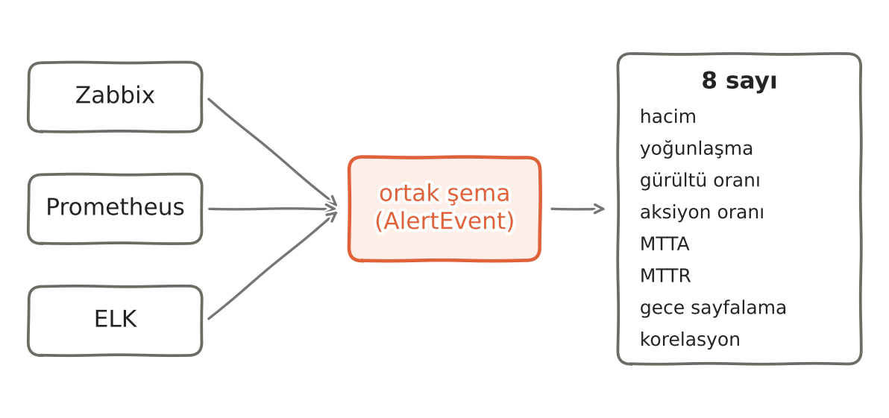

Prometheus'tan `ALERTS` serisini, Zabbix'ten `event.get` JSON-RPC çağrısını okuyorum. ELK'te alarmların nerede durduğu ortamdan ortama değiştiği için adaptör bir alan eşlemesi alıyor ve scroll API ile okuyor.

Burada itiraf var: bu ortamda gerçek bir Elasticsearch kuramadım. Elastic depolarına ve Docker Hub'a erişimim yoktu. Adaptörü bunun yerine Elasticsearch API'sini taklit eden küçük bir sunucuya karşı denedim. 2.843 sentetik alarmı toplayıp birebir aynı çıktığını gördüm. Bu, adaptörün mantığını sınıyor ama gerçek bir kümenin kimlik doğrulama ve sürüm pürüzlerini sınamıyor. Doküman şeması da varsayımsal. Kendi kümende denersen sonucu bana yaz.

### Neye baktım

Sekiz sayıya baktım: alarm hacmi, hacmin %80'ini kaç kuralın ürettiği (yoğunlaşma), gürültü oranı, aksiyon gerektiren oran, MTTA (alarmdan ilk müdahaleye geçen süre), MTTR (alarmdan çözüme geçen süre), gece sayfalama ve olay başına düşen alarm sayısı (korelasyon).

### Rapor

Üreticiyle 24 sunucu, 13 kural ve 30 gün için 5.570 alarm ürettim, günde 181 civarı. Rapor tek komutla çıkıyor:

```bash
python3 -m alerthealth analyze events.jsonl --out report.md
```

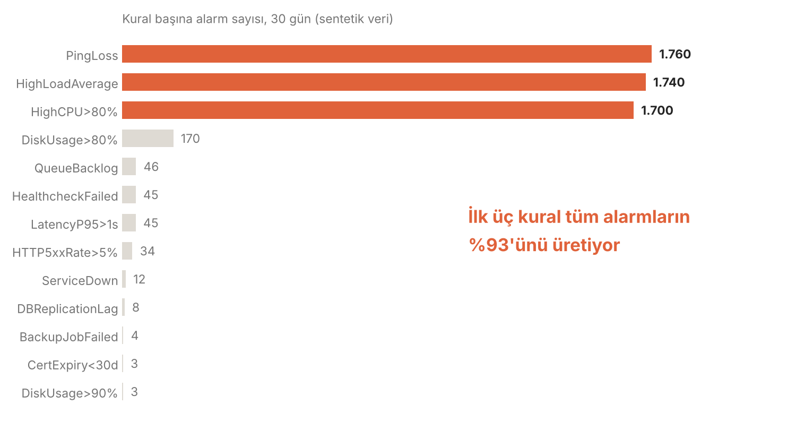

```
Hacmin %80'ini üreten kural : 3 / 13
Gürültülü kural             : 3 (hacmin %93'ü, 5.200 alarm)
Aksiyon gerektiren oran     : %7 (375 / 5.570)
Gece high/critical          : 80 alarm (haftada ~18)

MTTA medyan (dk)   critical 7,5 | high 7,6 | warning 8,2
MTTR medyan (dk)   critical 66,6 | high 67,9 | warning 2,3
```

Üç kural neredeyse her şeyi üretiyor ve bu kurallardaki alarmların yalnızca %3'ü bir insanı harekete geçirmiş. Warning MTTR'sinin 2,3 dakika olması da bundan: bu alarmların çoğu üç gürültülü kuraldan geliyor ve kısa sürüp kendiliğinden kapanıyor. Warning MTTA'sındaki 8,2 dakika da yanıltıcı: bu yalnızca ack edilen (biri "gördüm" diye işaretleyen) 465 alarmın medyanı. 5.370 warning'in %91'i hiç ack edilmemiş.

### Ne işe yaramadı

Bu bölüm bence en önemlisi. Üç yöntemim beklediğim gibi çalışmadı.

**Ham veriyi LLM'e vermek**

30 günlük JSONL 1,56 milyon karakter, kaba hesapla (karakter/3,5) yaklaşık 445 bin token. Aynı bilgiyi anlatan rapor 700 token civarı, yani 640 kat küçük. 445 bin token birçok modelin bağlam penceresine sığmaz, sığsa bile maliyeti ve gecikmesi saçma olur.

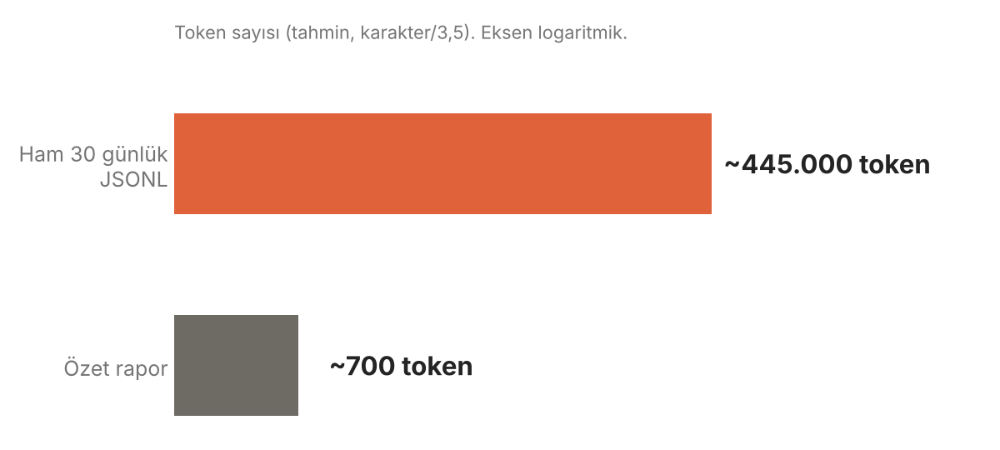

Ham veriyle kalite testi yapmadım, token sayıları da gerçek bir tokenizer'dan değil tahmin. Gerçek ölçümü sonraki yazıda yapacağım.

**Zamana göre gruplamak**

Basit bir kural yazdım: 5 dakikadan kısa aralıkla gelen, en az iki varlıktan en az üç alarm tek olay sayılsın. Sentetik veride 601 "olay" çıktı, gerçekte 12 incident vardı. 589 grup sadece gürültüydü.

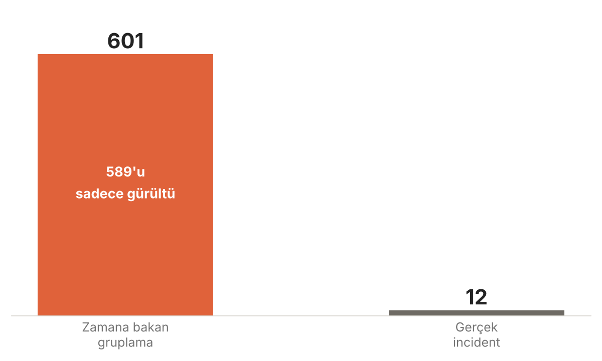

Labda da aynısı oldu: iki ayrı arıza ile ilgisiz bir alarm tek olay sayıldı. 7 alarm, 1 olay. Oysa 3 olay vardı. ELK alarmlarını da ekleyince olay başına düşen alarm sayısı 1,5'ten 2,1'e çıktı, yani gruplama daha iyi görünüyordu. Ama 1.187 grubun 1.175'i yine gürültüydü. Oran, gürültünün birbirine yapışmasıyla yükselmişti. Bu veride gürültü temizlenmeden yapılan korelasyon yanıltıcı oldu.

**Gürültülü kuralları susturmak**

Gürültü bayrağı 3 kuralı işaretledi. Hepsini sustursam 5.570 alarm 370'e düşüyor, aksiyon gerektiren oran %7'den %59'a çıkıyor. İlk bakışta harika.

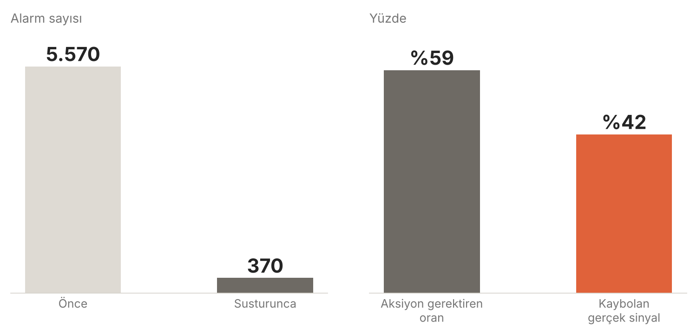

Ama bu kurallardaki alarmların %3'ü gerçekten aksiyon gerektirmişti. Bu 158 alarm, toplam 375'in %42'si. Toptan susturmak gerçek sinyalin neredeyse yarısını da atıyor. Çözüm eşiği doğru koymak, bu da üçüncü yazının konusu. Susturunca korelasyon da düzeliyor (12 grup, 12 incident). Yani bu veride sıra önemli oldu: önce gürültüyü azalt, sonra grupla.

**Kaçan bir kural**

Gürültü bayrağı, gerçekten gürültülü 4 kuraldan 3'ünü buldu. Yani bulduklarının hepsi doğruydu (precision %100) ama doğruların %75'ini buldu (recall %75). Kaçırdığı kural `DiskUsage>80%`: 170 alarm, medyan 17 saat süren, her gün yeniden bildirilen, %10'u aksiyon gerektiren bir kural. Kısa da değil, sık da değil. "Kısa ve sık" ölçütü "uzun ve bayat" gürültüyü görmüyor.

### Eksikler

Zabbix eski bir sürüm (5.0.17, resmi desteği sona ermiş), çünkü yeni sürümlerin depolarına erişemedim. Kullandığım API alanları 6.0 ve 7.0'da da var ama orada denemedim. Lab verisi çok küçük (7 alarm), yöntemi gösteriyor, istatistik üretmiyor. Aksiyon gerektiren oran için insan etiketi şart. Bu çalışma bahsettiğim ürünlerin yerine geçmiyor. Hangisini seçersen seç "önce nasıldı, sonra nasıl oldu" diyebilmek için bu ölçümlere ihtiyacın olacak.

### Sırada ne var

Sentetik veride aklımda kalan sıra şu: önce ölç, sonra gürültüyü azalt, sonra grupla, AI'ı en sona koy.

Sonraki yazıda veriyi LLM'e verilebilir bir özete çevirip "445 bin token" sorununu gerçek bir tokenizer ve gerçek bir modelle ölçeceğim.

### Sen de dene

Kodun hepsi GitHub'da: [https://github.com/Vedat-ayaz/Medium_MonitoringAIkatman-](https://github.com/Vedat-ayaz/Medium_MonitoringAIkatman-). Sentetik veriyle denemek için:

```bash
python3 -m alerthealth generate --days 30 --out events.jsonl
python3 -m alerthealth analyze events.jsonl --out report.md
```

Kendi ortamının verisi için `collect prometheus`, `collect zabbix` ve `collect elk` komutları var, ayrıntısı README'de.

Hangi monitoring ürünlerini kullanıyorsun, seni en çok ne yoruyor: gürültü mü, kök nedeni bulamamak mı? Yorumlara yaz.

---

**Kaynaklar**

- [Mezmo: The 2026 AI SRE Market Map](https://www.mezmo.com/learn/the-2026-ai-sre-market-map-agents-harnesses-and-the-data-layer)
- [Datadog: How we built an AI SRE agent](https://datadoghq.com/blog/building-bits-ai-sre/)
- [Datadog: Pricing (AI Credits)](https://www.datadoghq.com/pricing/?facet1=pdf)
- [Dynatrace: AI-driven analytics and automation](https://www.dynatrace.com/news/blog/ai-driven-analytics-and-automation-for-unified-observability/)
- [Dynatrace: Advancing AIOps with Davis AI](https://dynatrace.com/news/blog/advancing-aiops-preventive-operations-powered-by-davis-ai)
- [Dynatrace: rate card](https://dynatrace.com/pricing/rate-card)
- [Last9: Dynatrace pricing](https://last9.io/blog/dynatrace-pricing/)
- [Better Stack: Davis AI alternatives](https://betterstack.com/community/comparisons/davis-ai-alternatives/)
